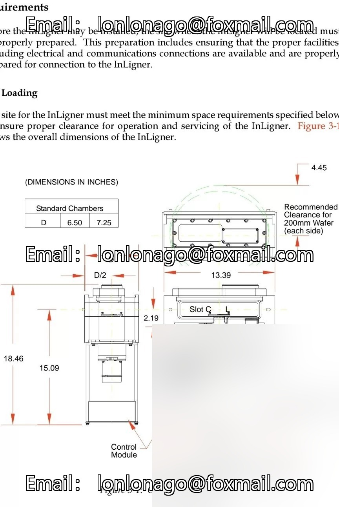
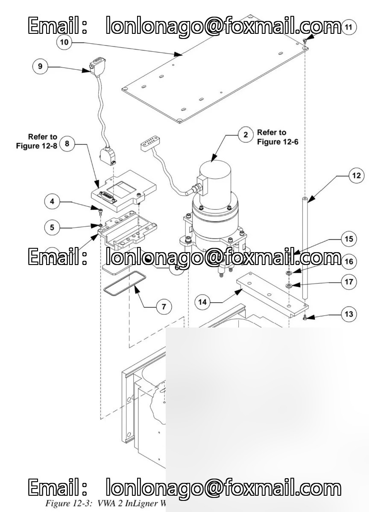

# Vacuum wafer alignment machine English manual

## Body

Vacuum wafer alignment machine English manual Brooks Automation VWA 2 InLigner Vacuum Wafer Alignment Machine (Single Axis) User Manual, original English version, containing detailed explanations on installation, operation, maintenance, etc., suitable for semiconductor equipment engineers, maintenance personnel, and reference for learning.
PDF 190 pages
refunded upon sale.

45362

The manual is the English version of a vacuum wafer alignment machine manual covering Brooks Automation VWA 2 InLigner (single-axis) installation, operation, maintenance and required facilities and space requirements.

<!-- AI_ENRICHED -->

## Images

## Payment

Here is a pay link on Stripe ( https://buy.stripe.com/3cs8yP7sY87d0vu9AB ). Please contact me lonlonago@foxmail.com after funding $89, and I will send you a complete data files , thank you!

